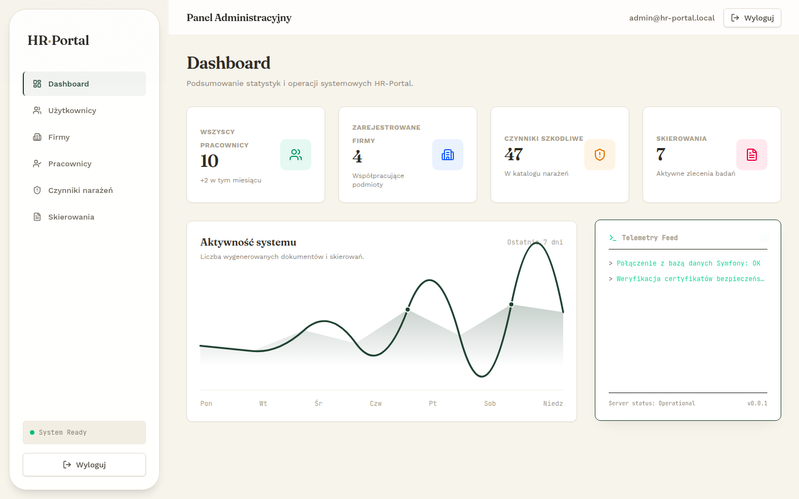
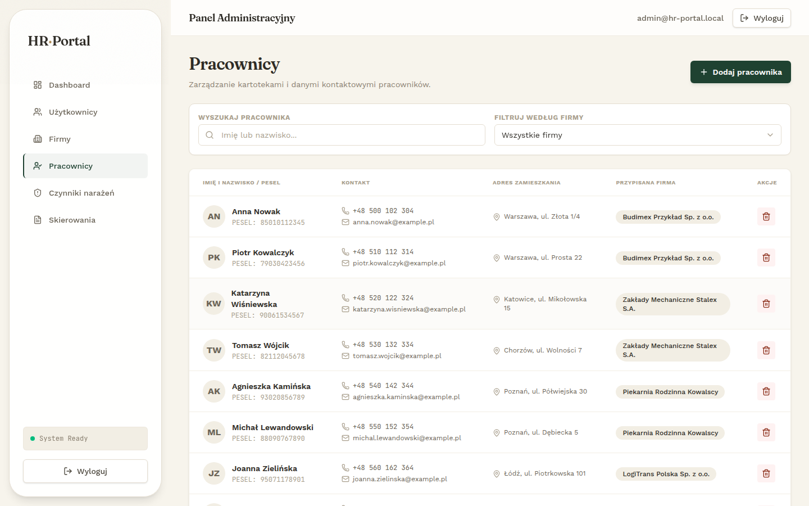
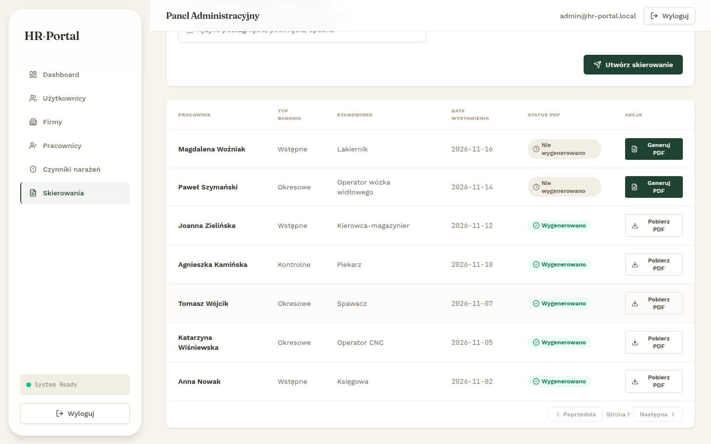
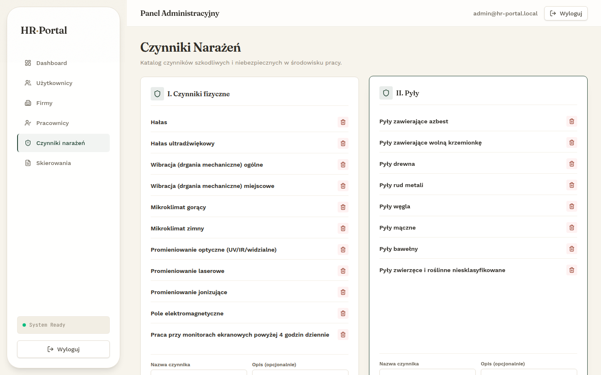
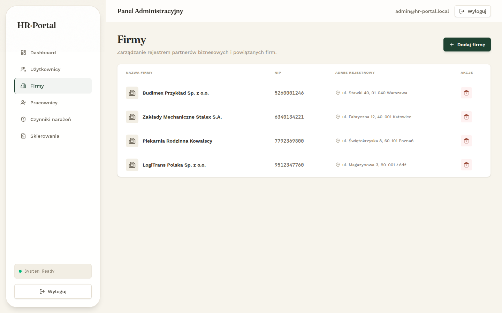
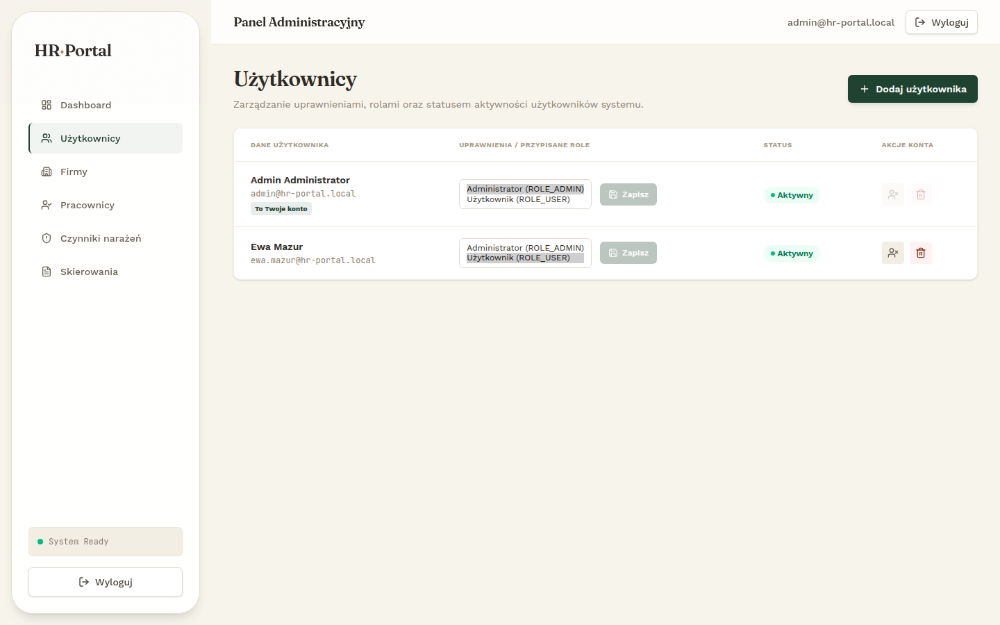
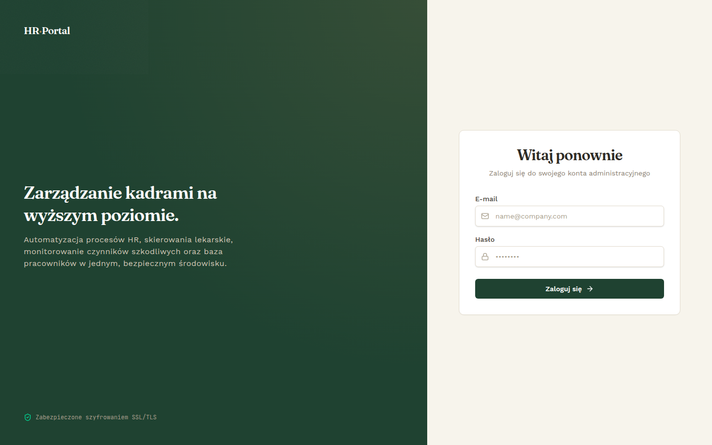
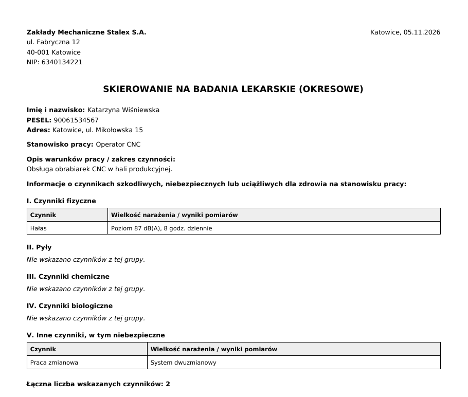
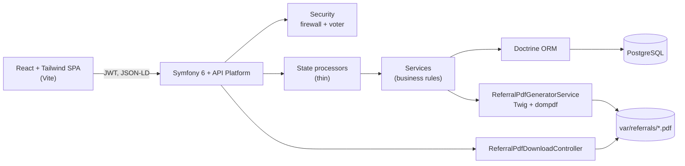

# HR-Portal

[Polski](README.pl.md) | English

[](https://github.com/JakubProgrammingWorkspace/HR-Portal/actions/workflows/ci.yml)


[](LICENSE)

A Polish HR management application covering **Users & flexible Roles**, **Companies**, **Employees**, an **occupational exposure factors catalogue**, and **standardized medical examination referrals with PDF generation**. Built with a **Symfony 6 + API Platform** backend (PHP 8.5, thick services / thin controllers) and a **React + Tailwind CSS** frontend, all running via Docker Compose.

> [!TIP]
> **💡 Training project** — This app was built as a **training experiment** to test whether complex, real-world applications can be created from a specification alone using AI coding agents. It demonstrates that with a clear PRD (product requirements document) and two autonomous AI agents working in tandem, a full-stack HR application is feasible with no upfront code — just a specification.

## Screenshots

| Dashboard | Employees |
|-----------|-----------|
|  |  |
| **Referrals** | **Exposure factors catalogue** |
|  |  |
| **Companies** | **Users (admin only)** |
|  |  |

Login page and generated referral PDF (excerpt):

| Login | Referral PDF |
|-------|--------------|
|  |  |

*Screenshots use the fictional records from the `demo` fixtures group (see Getting started).*

## Features

- **Authentication** — JWT login (`POST /api/login`); inactive accounts are rejected.
- **Users & roles** (admin only) — create, update, delete users; assign flexible roles (codes must match `ROLE_*`); you cannot delete or deactivate your own account.
- **Companies** — CRUD with NIP validation (10 digits); a company with employees cannot be deleted.
- **Employees** — CRUD with PESEL (11 digits) validation; search by name and filter by company in the UI.
- **Exposure factors catalogue** — five seeded categories (physical, dust, chemical, biological, other) with ~47 factors; add/remove factors (a factor used in a referral cannot be removed).
- **Medical examination referrals** — create referrals (initial / periodic / control) with selected exposure factors and exposure details, then generate and download a **PDF**.
- **Dashboard** — live counts of employees, companies, exposure factors and referrals (the activity chart and telemetry feed are decorative).
- **API docs** — OpenAPI/Swagger UI at `/api/docs` (public).

## How it was built: Claude Code + Ralph

This project was developed using two AI coding agents working together:

| Agent | Role |
|-------|------|
| **[Claude Code](https://claude.ai/code)** | Front-end design agent — responsible for the UI redesign, visual identity, and Polish "Organic Tech" design system (typography, color palette, floating sidebar, tables, forms, dashboard, login page). |
| **[Ralph](https://github.com/earendil-works/ralph)** | Autonomous backend agent — a structured iteration loop agent that reads a PRD file ([`prd.json`](docs/agent-workflow/prd.json)), picks the highest-priority user story with `passes: false`, implements it, runs quality checks, updates the PRD, and appends learnings to `progress.txt`. |

The workflow:

1. A **PRD** ([`prd.json`](docs/agent-workflow/prd.json), human-readable version: [`prd-hr-portal.md`](docs/agent-workflow/prd-hr-portal.md)) defines all user stories, acceptance criteria, priorities, and iteration state (`passes: true/false`).
2. **Ralph** ([`ralph.sh`](docs/agent-workflow/ralph.sh), prompt: [`RALPH_CLAUDE.md`](docs/agent-workflow/RALPH_CLAUDE.md)) iterates through stories one-by-one, implementing each, checking quality, and committing.
3. **Claude Code** handles the visual redesign (see [`INSTRUCTION.md`](docs/agent-workflow/INSTRUCTION.md) and [`GEN_UI_DESIGN.md`](docs/agent-workflow/GEN_UI_DESIGN.md)) — typography, color system, components, pages, and micro-interactions.
4. A [`progress.txt`](docs/agent-workflow/progress.txt) log accumulates learnings, patterns, and gotchas across iterations so future runs don't repeat mistakes.

This project proves that specifying what you want — and letting AI agents build it — is a viable workflow for building real applications.

All workflow artifacts live in [`docs/agent-workflow/`](docs/agent-workflow/).

## Stack

- **php** — PHP 8.5-FPM running the Symfony 6 backend (`backend/`)
- **nginx** — serves the backend on `http://localhost:8000`
- **postgres** — PostgreSQL 16 database
- **node** — Vite dev server for the React frontend (`frontend/`), on `http://localhost:5173`

## Architecture



**Backend (`backend/src`)**

| Layer | Contents |
|-------|----------|
| `Entity` | Company, Employee, ExposureCategory, ExposureFactor, Referral, ReferralExposureFactor, Role, User — each declares its API Platform operations with `#[ApiResource]`. |
| `Dto` + `Validator` | Input DTOs with validation constraints; custom constraints (`UniqueRoleCode`, `ValidCompanyReference`, ...) |
| `State` | API Platform processors, one per write operation. They only translate the request into a service call. |
| `Service` | Business logic ("thick services"): e.g. `CompanyService`, `UserService`, `ReferralService`. |
| `Controller` | Thin: `/api/health`, login, and `ReferralPdfDownloadController` (streams the stored PDF). |
| `Security` | `UserChecker` (blocks inactive accounts), `UserManagementVoter`. |

**PDF generation** — `POST /api/referrals/{id}/generate-pdf` calls `ReferralService::generatePdf()`, which uses `ReferralPdfGeneratorService` to render `templates/referral_pdf.html.twig` (exposure factors grouped by category) with dompdf and store it under `var/referrals/`. `GET /api/referrals/{id}/pdf` returns the file.

**Authentication & roles** — `lexik/jwt-authentication-bundle` issues JWTs (payload includes id, email, roles). The `/api` firewall is stateless; everything except `/api/login` and `/api/docs` requires a valid token. `/api/users` and `/api/roles` additionally require the `MANAGE_USERS` attribute, granted by `UserManagementVoter` to `ROLE_ADMIN`. The frontend mirrors this with `RequireAuth` / `RequireAdmin` route guards.

**Tests** — PHPUnit suites in `backend/tests` (API CRUD, login, voter, PDF service, fixtures) run against PostgreSQL; CI runs them plus PHPStan and the frontend type-check/build.

## Getting started

1. Copy the example environment file and adjust values if needed:

   ```bash
   cp .env.example .env
   ```

2. Start the stack:

   ```bash
   docker compose up -d
   ```

   - Backend API: http://localhost:8000
   - Frontend dev server: http://localhost:5173

3. Install backend dependencies and run database migrations:

   ```bash
   docker compose exec php composer install
   docker compose exec php bin/console doctrine:database:create --if-not-exists
   docker compose exec php bin/console doctrine:migrations:migrate --no-interaction
   ```

4. Generate the JWT signing keys used for authentication (writes
   `backend/config/jwt/{private,public}.pem`, gitignored):

   ```bash
   docker compose exec php bin/console lexik:jwt:generate-keypair --skip-if-exists
   ```

5. Load fixtures. Base data (roles, default admin user, exposure factors catalogue):

   ```bash
   docker compose exec php bin/console doctrine:fixtures:load --group=base --no-interaction
   ```

   Optionally load fictional Polish demo records instead (companies, employees, referrals, a second user; includes the base data):

   ```bash
   docker compose exec php bin/console doctrine:fixtures:load --group=demo --no-interaction
   ```

   Both commands purge the database first.

6. Stop the stack:

   ```bash
   docker compose down
   ```

## Default admin account

After loading fixtures, log in with:

- **Email:** `admin@hr-portal.local`
- **Password:** `admin123`

(see `backend/src/DataFixtures/AppFixtures.php`). The demo group adds a regular user: `ewa.mazur@hr-portal.local` / `user12345`. These are local development credentials only — change them for any real deployment.

## Authentication

`POST /api/login` accepts `{ "email": "...", "password": "..." }` and returns
`{ "token": "<jwt>" }` on success (401 on invalid credentials or an inactive
account). All other `/api/*` routes (except `/api/login` and `/api/docs`)
require an `Authorization: Bearer <token>` header. The token TTL defaults to
3600 seconds and is configurable via `JWT_TOKEN_TTL` in `.env`.

## Validating the Docker setup

```bash
docker compose config   # validate the compose file
docker compose up        # start all services
```

## Running the tests

```bash
# backend (needs the postgres service from docker compose)
docker compose exec -e APP_ENV=test php bin/console doctrine:database:create --if-not-exists
docker compose exec -e APP_ENV=test php bin/console doctrine:migrations:migrate --no-interaction
docker compose exec -e APP_ENV=test php bin/phpunit

# static analysis (PHPStan level 6)
docker compose exec php bin/console cache:warmup
docker compose exec php vendor/bin/phpstan analyse

# frontend
cd frontend && npm ci && npm run build
```

## License

[MIT](LICENSE)
