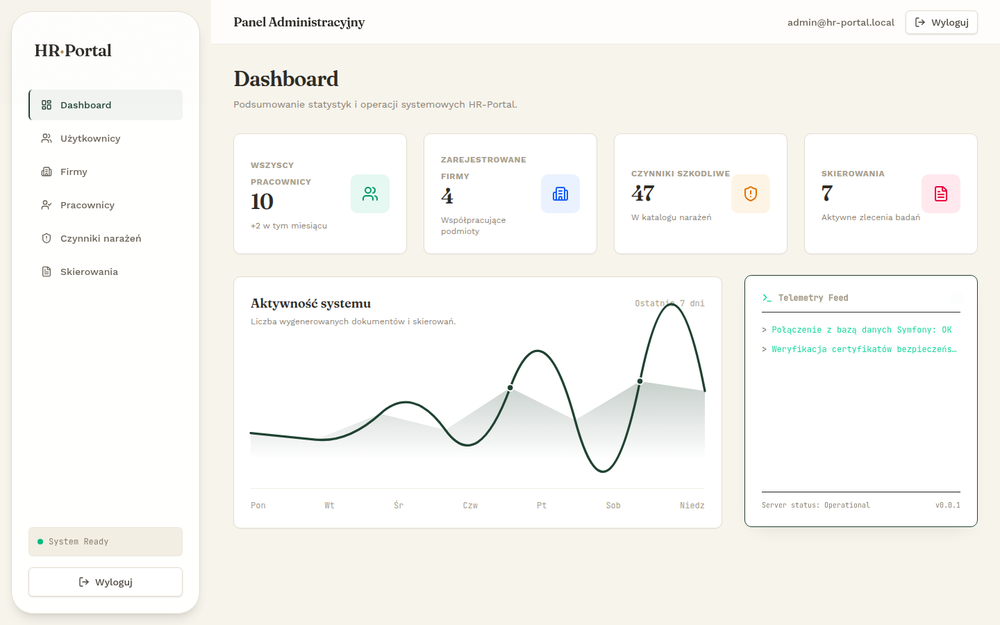
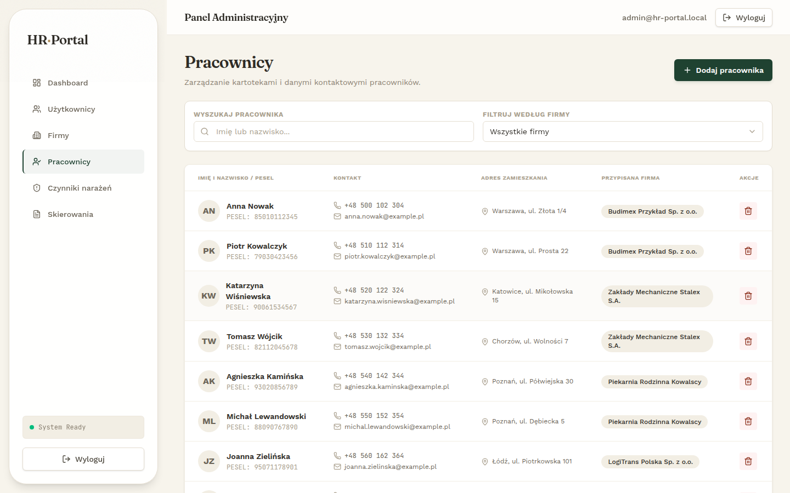
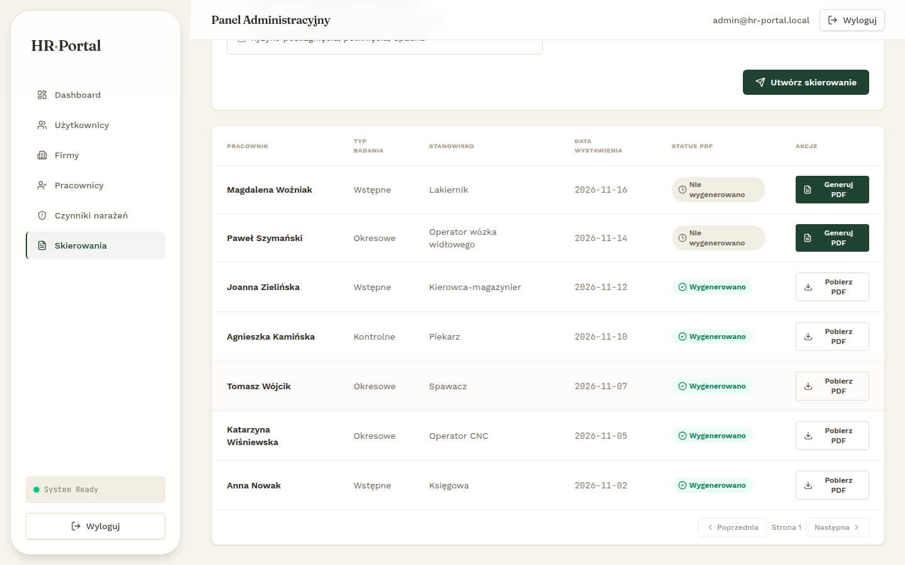
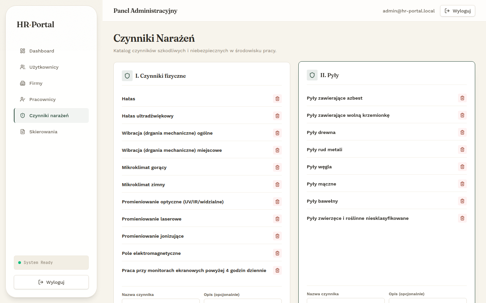
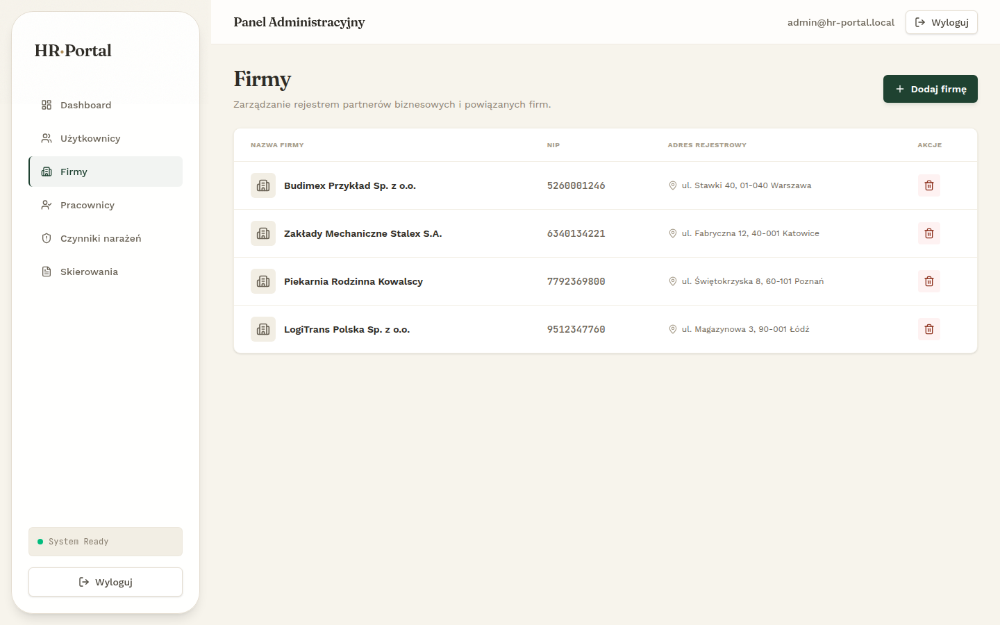
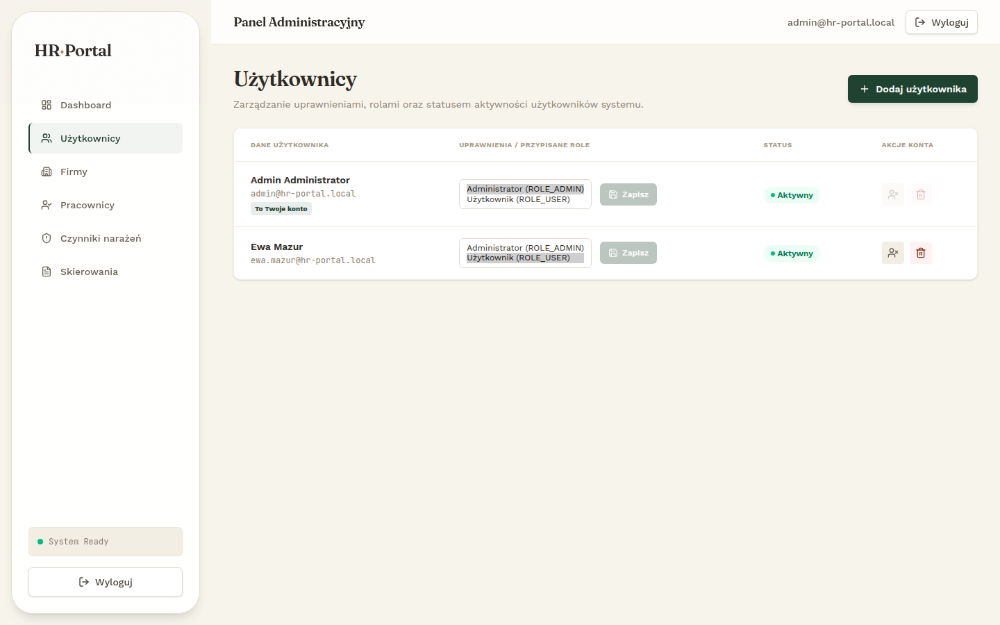
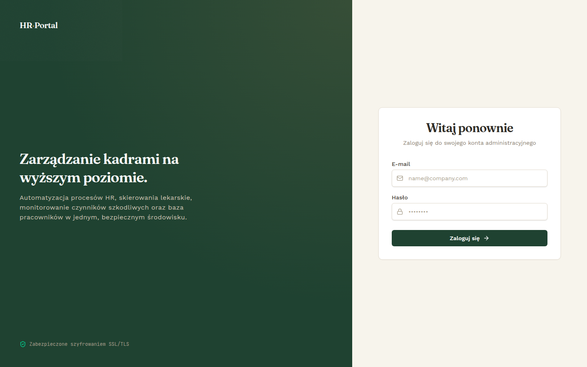
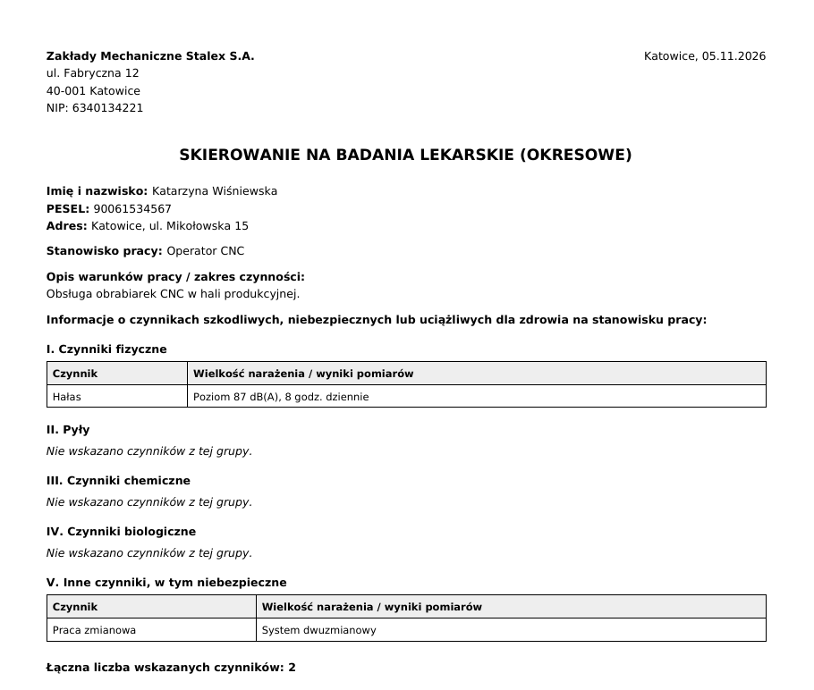
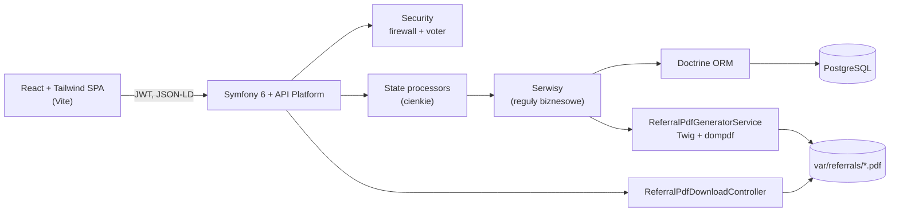

# HR-Portal

Polski | [English](README.md)

[](https://github.com/JakubProgrammingWorkspace/HR-Portal/actions/workflows/ci.yml)


[](LICENSE)

Polska aplikacja do zarządzania kadrami: **użytkownicy i elastyczne role**, **firmy**, **pracownicy**, **katalog czynników narażenia zawodowego** oraz **ustandaryzowane skierowania na badania lekarskie z generowaniem PDF**. Backend oparty na **Symfony 6 + API Platform** (PHP 8.5, gruba warstwa serwisów / cienkie kontrolery), frontend na **React + Tailwind CSS**, całość uruchamiana przez Docker Compose.

> [!TIP]
> **💡 Projekt szkoleniowy** — Aplikacja powstała jako **eksperyment szkoleniowy**, mający sprawdzić, czy złożone, realistyczne aplikacje można stworzyć wyłącznie na podstawie specyfikacji, używając autonomicznych agentów AI. Pokazuje, że dzięki jasnemu PRD (dokumentowi wymagań produktowych) i dwóm współpracującym agentom AI można zbudować pełną aplikację HR bez wcześniejszego kodu — wystarczy specyfikacja.

## Zrzuty ekranu

| Dashboard | Pracownicy |
|-----------|------------|
|  |  |
| **Skierowania** | **Katalog czynników narażenia** |
|  |  |
| **Firmy** | **Użytkownicy (tylko admin)** |
|  |  |

Strona logowania i wygenerowane skierowanie w PDF (fragment):

| Logowanie | Skierowanie PDF |
|-----------|-----------------|
|  |  |

*Zrzuty ekranu pochodzą z fikcyjnych rekordów z grupy fixtures `demo` (zob. „Uruchomienie”).*

## Funkcje

- **Uwierzytelnianie** — logowanie JWT (`POST /api/login`); konta nieaktywne są odrzucane.
- **Użytkownicy i role** (tylko admin) — tworzenie, edycja i usuwanie użytkowników; przypisywanie elastycznych ról (kod musi pasować do `ROLE_*`); nie można usunąć ani dezaktywować własnego konta.
- **Firmy** — CRUD z walidacją NIP (10 cyfr); firmy z przypisanymi pracownikami nie można usunąć.
- **Pracownicy** — CRUD z walidacją PESEL (11 cyfr); wyszukiwanie po imieniu i nazwisku oraz filtrowanie po firmie w interfejsie.
- **Katalog czynników narażenia** — pięć kategorii (fizyczne, pyły, chemiczne, biologiczne, inne) z ok. 47 czynnikami; dodawanie i usuwanie czynników (czynnika użytego w skierowaniu nie można usunąć).
- **Skierowania na badania lekarskie** — tworzenie skierowań (wstępne / okresowe / kontrolne) z wybranymi czynnikami narażenia i opisem narażenia, następnie generowanie i pobieranie **PDF**.
- **Dashboard** — aktualne liczby pracowników, firm, czynników narażenia i skierowań (wykres aktywności i „telemetry feed” są dekoracyjne).
- **Dokumentacja API** — OpenAPI/Swagger UI pod `/api/docs` (publiczna).

## Jak powstał projekt: Claude Code + Ralph

Projekt został stworzony przez dwóch współpracujących agentów AI:

| Agent | Rola |
|-------|------|
| **[Claude Code](https://claude.ai/code)** | Agent frontendowy — odpowiada za redesign UI, identyfikację wizualną i polski system designu „Organic Tech” (typografia, paleta kolorów, pływający sidebar, tabele, formularze, dashboard, strona logowania). |
| **[Ralph](https://github.com/earendil-works/ralph)** | Autonomiczny agent backendowy — pętla iteracyjna, która czyta plik PRD ([`prd.json`](docs/agent-workflow/prd.json)), wybiera user story o najwyższym priorytecie z `passes: false`, implementuje je, uruchamia kontrole jakości, aktualizuje PRD i dopisuje wnioski do `progress.txt`. |

Przebieg pracy:

1. **PRD** ([`prd.json`](docs/agent-workflow/prd.json), wersja do czytania: [`prd-hr-portal.md`](docs/agent-workflow/prd-hr-portal.md)) definiuje wszystkie user stories, kryteria akceptacji, priorytety i stan iteracji (`passes: true/false`).
2. **Ralph** ([`ralph.sh`](docs/agent-workflow/ralph.sh), prompt: [`RALPH_CLAUDE.md`](docs/agent-workflow/RALPH_CLAUDE.md)) realizuje historyjki jedna po drugiej: implementuje, sprawdza jakość i commituje.
3. **Claude Code** odpowiada za redesign wizualny (zob. [`INSTRUCTION.md`](docs/agent-workflow/INSTRUCTION.md) i [`GEN_UI_DESIGN.md`](docs/agent-workflow/GEN_UI_DESIGN.md)) — typografię, system kolorów, komponenty, strony i mikrointerakcje.
4. Log [`progress.txt`](docs/agent-workflow/progress.txt) gromadzi wnioski, wzorce i pułapki z kolejnych iteracji, aby kolejne uruchomienia nie powtarzały błędów.

Projekt pokazuje, że opisanie tego, czego się chce — i oddanie budowy agentom AI — to realny sposób tworzenia prawdziwych aplikacji.

Wszystkie artefakty procesu znajdują się w [`docs/agent-workflow/`](docs/agent-workflow/).

## Stack

- **php** — PHP 8.5-FPM z backendem Symfony 6 (`backend/`)
- **nginx** — udostępnia backend pod `http://localhost:8000`
- **postgres** — baza PostgreSQL 16
- **node** — serwer deweloperski Vite dla frontendu React (`frontend/`), pod `http://localhost:5173`

## Architektura



**Backend (`backend/src`)**

| Warstwa | Zawartość |
|---------|-----------|
| `Entity` | Company, Employee, ExposureCategory, ExposureFactor, Referral, ReferralExposureFactor, Role, User — każda deklaruje operacje API Platform przez `#[ApiResource]`. |
| `Dto` + `Validator` | Wejściowe DTO z regułami walidacji; własne constrainty (`UniqueRoleCode`, `ValidCompanyReference`, ...) |
| `State` | Procesory API Platform, po jednym na operację zapisu. Tylko przekładają żądanie na wywołanie serwisu. |
| `Service` | Logika biznesowa („gruba warstwa serwisów”): np. `CompanyService`, `UserService`, `ReferralService`. |
| `Controller` | Cienkie: `/api/health`, logowanie oraz `ReferralPdfDownloadController` (zwraca zapisany PDF). |
| `Security` | `UserChecker` (blokuje konta nieaktywne), `UserManagementVoter`. |

**Generowanie PDF** — `POST /api/referrals/{id}/generate-pdf` wywołuje `ReferralService::generatePdf()`, który używa `ReferralPdfGeneratorService` do wyrenderowania `templates/referral_pdf.html.twig` (czynniki pogrupowane według kategorii) przy pomocy dompdf i zapisania pliku w `var/referrals/`. `GET /api/referrals/{id}/pdf` zwraca ten plik.

**Uwierzytelnianie i role** — `lexik/jwt-authentication-bundle` wydaje tokeny JWT (payload zawiera id, e-mail i role). Firewall `/api` jest bezstanowy; wszystko poza `/api/login` i `/api/docs` wymaga poprawnego tokenu. `/api/users` i `/api/roles` wymagają dodatkowo atrybutu `MANAGE_USERS`, przyznawanego przez `UserManagementVoter` roli `ROLE_ADMIN`. Frontend odzwierciedla to guardami tras `RequireAuth` / `RequireAdmin`.

**Testy** — zestawy PHPUnit w `backend/tests` (CRUD API, logowanie, voter, serwis PDF, fixtures) działają na PostgreSQL; CI uruchamia je razem z PHPStan oraz kontrolą typów i buildem frontendu.

## Uruchomienie

1. Skopiuj przykładowy plik środowiskowy i w razie potrzeby dostosuj wartości:

   ```bash
   cp .env.example .env
   ```

2. Uruchom stack:

   ```bash
   docker compose up -d
   ```

   - API backendu: http://localhost:8000
   - Serwer deweloperski frontendu: http://localhost:5173

3. Zainstaluj zależności backendu i wykonaj migracje bazy:

   ```bash
   docker compose exec php composer install
   docker compose exec php bin/console doctrine:database:create --if-not-exists
   docker compose exec php bin/console doctrine:migrations:migrate --no-interaction
   ```

4. Wygeneruj klucze JWT używane do uwierzytelniania (zapisuje
   `backend/config/jwt/{private,public}.pem`, pliki są w `.gitignore`):

   ```bash
   docker compose exec php bin/console lexik:jwt:generate-keypair --skip-if-exists
   ```

5. Załaduj fixtures. Dane bazowe (role, domyślny admin, katalog czynników narażenia):

   ```bash
   docker compose exec php bin/console doctrine:fixtures:load --group=base --no-interaction
   ```

   Opcjonalnie załaduj zamiast tego fikcyjne polskie dane demo (firmy, pracownicy, skierowania, drugi użytkownik; zawiera dane bazowe):

   ```bash
   docker compose exec php bin/console doctrine:fixtures:load --group=demo --no-interaction
   ```

   Obie komendy najpierw czyszczą bazę.

6. Zatrzymaj stack:

   ```bash
   docker compose down
   ```

## Domyślne konto administratora

Po załadowaniu fixtures zaloguj się danymi:

- **E-mail:** `admin@hr-portal.local`
- **Hasło:** `admin123`

(zob. `backend/src/DataFixtures/AppFixtures.php`). Grupa demo dodaje zwykłego użytkownika: `ewa.mazur@hr-portal.local` / `user12345`. Są to wyłącznie lokalne dane deweloperskie — w prawdziwym wdrożeniu należy je zmienić.

## Uwierzytelnianie

`POST /api/login` przyjmuje `{ "email": "...", "password": "..." }` i zwraca
`{ "token": "<jwt>" }` w przypadku sukcesu (401 przy błędnych danych lub
nieaktywnym koncie). Wszystkie pozostałe trasy `/api/*` (poza `/api/login` i
`/api/docs`) wymagają nagłówka `Authorization: Bearer <token>`. Czas życia tokenu
domyślnie wynosi 3600 sekund i jest konfigurowalny przez `JWT_TOKEN_TTL` w `.env`.

## Weryfikacja konfiguracji Dockera

```bash
docker compose config   # walidacja pliku compose
docker compose up        # uruchomienie wszystkich usług
```

## Uruchamianie testów

```bash
# backend (wymaga usługi postgres z docker compose)
docker compose exec -e APP_ENV=test php bin/console doctrine:database:create --if-not-exists
docker compose exec -e APP_ENV=test php bin/console doctrine:migrations:migrate --no-interaction
docker compose exec -e APP_ENV=test php bin/phpunit

# analiza statyczna (PHPStan, poziom 6)
docker compose exec php bin/console cache:warmup
docker compose exec php vendor/bin/phpstan analyse

# frontend
cd frontend && npm ci && npm run build
```

## Licencja

[MIT](LICENSE)
